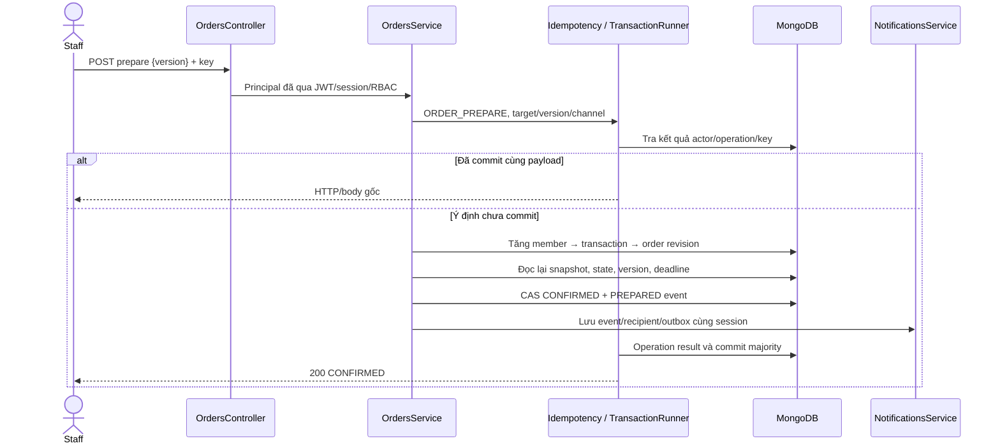
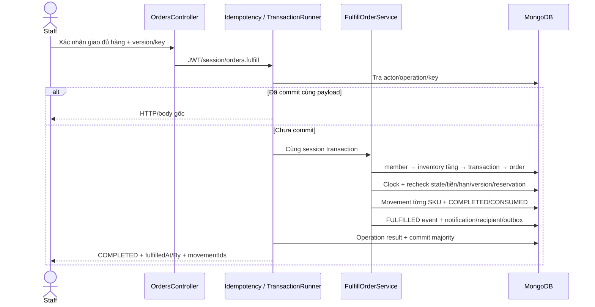

# US-43/44 — Chuẩn bị và bàn giao đơn website

Tích hợp US-53: đã mở `/api/pos/orders/:id/fulfill` với permission pos.fulfill và
operation ORDER_FULFILL_POS; gọi cùng `FulfillOrderService` policy POS. Summary chọn
policy theo channel để đơn POS SETTLED có action bàn giao hợp lệ. Prepare/fulfill
website vẫn từ chối POS409. POS factory và RETAIL settlement thật nằm trong US-53;
các suite US-43/44 cũ vẫn dùng fixture lịch sử như mô tả bên dưới, suite POS kiểm
writer mới và race thu/hủy/giao. Xem [pos-contract.md](pos-contract.md).

Nguồn: `PM/SPRINT6/[GM]Requirement_US-43.docx` v1.0, hợp đồng schema/H01/O01
trong US-41 và EN-06. Đã đọc toàn bộ văn bản và bảng của ba DOCX; không có ảnh
nhúng. Tham chiếu schema refund của US-45 để chỉ trả summary an toàn.

## API và quyền

| Endpoint | Quyền cố định | Hợp đồng |
| --- | --- | --- |
| `GET /api/orders` | `orders.read`, STAFF/ADMIN | channel, status, transactionStatus, q, memberId, fromDate, toDate, page, limit |
| `GET /api/orders/:id` | `orders.read`, STAFF/ADMIN | snapshot items/recipient/quầy, states/version/deadline, invoice/refunds summary, permittedActions |
| `POST /api/orders/:id/prepare` | `orders.prepare`, STAFF/ADMIN | `{version}`, UUID v4 Idempotency-Key, operation `ORDER_PREPARE`, HTTP 200 |
| `GET /api/operations/ORDER_PREPARE/:key` | STAFF/ADMIN, chính actor | Kết quả commit gốc; không tìm thấy không chứng minh thất bại |

Guard hiện có kiểm JWT, account/session/auth_version và vai trò mỗi request,
kể cả replay/lookup. Quyền read và prepare có metadata riêng; repo đang áp
dụng mapping vai trò cố định, không có override quyền từng tài khoản.
Thu RETAIL còn chờ writer US-41; bàn giao được bổ sung theo US-44 bên dưới.

List mặc định page1/limit20, tối đa100; sắp created_at DESC/_id DESC,
q tìm literal code đã trim≤120. Ngày Việt Nam bao gồm hai đầu, mặc định30 ngày
gần nhất, tối đa366 ngày. Query ngoài allowlist bị400. Count, transaction join
và dữ liệu một response đọc cùng snapshot. Empty có totalPages0.
API không trả evidence, reference ngân hàng, payout/credential, request key
hoặc guard_revision. Tiền là chuỗi nguyên VND; timestamp ISO UTC.

## UC-24: nhánh chuẩn bị

1. Staff/Admin mở `/staff/orders` hoặc `/admin/orders`, mặc định WEBSITE/PENDING.
2. Mở detail, xem snapshot và hạn giữ; kiểm hàng thực tế và đánh dấu xác nhận.
3. Gửi command với version hiện tại và một key. Giữ key/version khi mất phản hồi;
   tra operation hoặc gửi lại đúng yêu cầu. Không sinh key mới để sửa kết quả.
4. Server thực hiện một UnitOfWork: kiểm replay trước version; đọc ID bất biến,
   ghi tăng member.service_revision → transaction.guard_revision → order.guard_revision.
   Đọc lại order/transaction/items và lấy ServerClock sau khóa trên mỗi retry.
5. Chỉ WEBSITE/PENDING/HELD, chưa đến hạn, transaction RETAIL PENDING hoặc SETTLED
   hợp lệ. Kiểm owner liên kết, snapshot, tổng dòng/transaction, hạn created_at+24h.
   SETTLED cần invoice đúng tổng và payment SUCCEEDED đúng tổng; đơn0 có invoice0,
   không payment0. Không đọc giá/trạng thái catalog hiện tại.
6. CAS version: PENDING→CONFIRMED, confirmed_at/by và updated_at, version+1.
   Không đổi transaction business version/status, tồn/movement/payment/invoice/hạn.
7. Cùng session ghi order_events PREPARED, before/after status/version,
   event_key unique `ORDER_CONFIRMED:<id>`; notification/recipient/outbox EN-03
   và operation result. Recipient lấy dưới member gate tại commit. Không account
   vẫn lưu source event/notification, không tạo recipient giả. Socket do worker sau commit.
8. Cùng key/payload replay body200 gốc. Key khác trên CONFIRMED trả409
   ORDER_ALREADY_CONFIRMED với ID/version hiện tại, giữ nguyên confirmed timestamp/actor.
   Conflict khác tải lại detail/list và yêu cầu kiểm hàng lại.

GET hết hạn chỉ báo expired; không tự hủy/release. Đúng mốc bằng deadline đã
hết hạn. UI không gia hạn, không gọi chuẩn bị là đã thu hoặc đã bàn giao.
Thông báo dùng outbox/REST/dedupe EN-03 hiện có, không thêm socket riêng.



## Schema và vận hành

`orders`, `order_items`, `order_events` được khai báo theo US-41, không tạo
checkout/factory thay thế. Snapshot quầy hiện dùng chuỗi địa điểm
`pickup_location_snapshot`; writer US-41 cần dùng cùng biểu diễn khi được triển khai.
Order code/transaction unique, items(order,product) unique, event_key unique;
index member/channel/status/created/expiry phục vụ truy vấn. Không TTL.

Chạy `npm run ensure-indexes` và `npm run seed:access` ở backend trước khi dùng.
Preflight không sửa snapshot hoặc tiền/hạn; từ chối dữ liệu thiếu/sai revision,
orphan, sai tổng/state và reserved không khớp tổng HELD. Cần dừng writer khi chạy
preflight/đối chiếu; không tự reset reserved hoặc tạo lại dữ liệu lịch sử.
Prepare từ chối ghi nếu thiếu index bắt buộc. Không thêm env/dependency.

## Kiểm thử và giới hạn nghiệm thu

`npm run build` trước `npm run test:integration -- --runTestsByPath test/order-prepare.integration-spec.ts`.
Suite dùng MongoDB replica set8.0.17 thật, hai child Nest process/hai connection,
HTTP/JWT/session Guard thật, không mutex memory. Fixture order/item/reservation/
payment là dữ liệu test được ghi rõ trong test vì chưa có US-41 factory.
Các fixture này không chứng minh luồng tạo đơn hoặc thu RETAIL đã hoàn thành.

| Requirement | Bằng chứng tự động được triển khai | Giới hạn |
| --- | --- | --- |
| TC01–05, TC08 | Quyền/kênh/DTO, pending/settled/free, snapshot/tổng/hạn, so DB trước–sau | Checkout/retail payment writer chưa có |
| TC06 | Fault event/recipient/outbox/key, rollback cả status/guards và dữ liệu liên quan | Không giả rollback khoản thu thực ngoài hệ thống |
| TC07 | Không account/offline vẫn source event; member REST sync đúng recipient | Dedupe socket dùng EN-03 hiện có |
| TC09 | Pause trước khóa, fixture đổi version/cancelled hoặc clock rồi resume | Chưa phải race với command cancel/expiry/payment thật |
| TC10 | 10 vòng ×20 cùng key, 10 vòng hai key, hai process; một event/key/transition | Không thay toàn bộ EN-06 |
| TC11 | Mất response sau commit, lookup/replay, payload/target khác409, revoked401 | Không coi lookup404 là thất bại đã biết |
| TC12 | API ngày VN/phân trang; frontend loading/empty/error/pending/permission/recovery | Chưa duyệt UI thủ công trên trình duyệt |

Frontend: `npm test -- src/features/orders/orders.test.tsx`.
US-43-AC01/02 có kiểm thử phạm vi chuẩn bị; **AC03 và Done vẫn chưa đủ bằng chứng**
cho cạnh tranh liên story. US-41 (create/normal RETAIL settlement) chưa có writer;
US-45 hiện có cancel/expiry/late/refund và suite riêng theo `order-cancellation-contract.md`.
US-44 được triển khai bên dưới. Chạy EN-04 và toàn EN-06 sau
khi tích hợp các dependency; không đánh dấu Done từ kết quả build hoặc fixture.

## US-44 — UC-24 nhánh bàn giao tại quầy

Nguồn: `PM/SPRINT6/[GM]Requirement_US-44.docx` v1.0; đã đọc văn bản, toàn bộ
bảng và xác nhận không có drawing/object nhúng. Đối chiếu O01/H01 của US-41,
US-45 và policy POS/operation của US-53. Không sửa hợp đồng nguồn DOCX.

| API / policy | Hợp đồng |
| --- | --- |
| `POST /api/orders/:id/fulfill` | STAFF/ADMIN, `orders.fulfill`, `{version}`, UUID v4; HTTP200 FulfillmentResult |
| `GET /api/operations/ORDER_FULFILL_WEBSITE/:key` | Chính actor còn quyền; kết quả HTTP/body gốc |
| `GET /api/orders/:id` | Thêm fulfilledAt/fulfilledBy/movementIds và permittedActions.fulfill/fulfillBlockedReason |
| Shared service POS | `FulfillOrderService.fulfill(..., 'POS')`, operation ORDER_FULFILL_POS, policy pos.fulfill được khai báo để US-53 tái sử dụng; chưa mở route POS |

FulfillmentResult: `{id, code, status:"COMPLETED", reservationState:"CONSUMED",
version, fulfilledAt, fulfilledBy, movementIds, notificationState}`. Timestamp
là server ISO UTC; UI hiển thị giờ Việt Nam. Không trả bank reference/contact
qua notification, không gọi settlement hoặc phát hành invoice lần nữa.

1. Staff mở đơn CONFIRMED, xem snapshot mã đơn/người nhận/liên hệ/sản phẩm,
   tổng, chứng từ thu và deadline. Đánh dấu đã đối chiếu và giao đủ hàng thực tế;
   không QR, không giao từng phần, không tự gọi handover từ SETTLED hoặc socket.
2. Lệnh chạy trong IdempotencyService/TransactionRunner: replay trước version
   và preflight. Chỉ tra ID bất biến trước khóa; khóa member nếu có → inventory
   theo productId tăng qua InventoryWriter → transaction → order. Lấy clock
   sau tất cả khóa trên mỗi retry; chỉ hợp lệ khi clock < createdAt+24 giờ.
3. Recheck đúng channel, CONFIRMED/HELD, SETTLED, version và snapshot/tổng.
   Invoice đúng tổng; total>0 có đúng một payment SUCCEEDED đúng tiền,
   verifiedBy/paidAt; total0 có invoice0 và không payment. Dữ liệu bất thường
   trả409 ORDER_INTEGRITY_ERROR để đối chiếu. Không đọc catalog live.
4. Kiểm inventory/ledger và provenance ORDER_RESERVE của từng item; reserved
   phải khớp tổng HELD của SKU, reserved≥q và onHand≥reserved. Dữ liệu sai/mất
   reservation trả409 INVENTORY_INTEGRITY_ERROR; không bù reserved hoặc ép âm.
5. Mỗi item ghi ORDER_FULFILL:<itemId>, delta(−q,−q), before/after, sequence,
   actor/source/orderItem cùng session. Không tạo stock_document ISSUE. CAS đơn
   COMPLETED/CONSUMED, fulfilled_by/at, updated_at, version+1. Giữ nguyên hạn,
   invoice, payment và transaction business version/status.
6. Cùng commit ghi audit order_events FULFILLED, event unique
   ORDER_COMPLETED:<orderId>, notification/recipient/outbox và operation result.
   Không linked account vẫn lưu source/outbox, trả NO_LINKED_ACCOUNT. Socket
   worker lỗi/offline sau commit không phủ nhận bàn giao đã hoàn tất.
7. Cùng key replay200 IDs/thời gian gốc. Key khác khi COMPLETED trả409
   ORDER_ALREADY_COMPLETED với id/version/fulfilledAt/fulfilledBy/movementIds
   trong error.details; payload/target khác cùng key trả IDEMPOTENCY_CONFLICT.
   Mốc expiry bằng/sau trả RESERVATION_EXPIRED; GET chỉ báo expired, không release.
8. UI lưu key/version theo actor/order trong sessionStorage khi gửi. Mất phản
   hồi giữ yêu cầu, khóa điều hướng trong trang và cho lookup/replay/đọc trạng
   thái. Lookup404 không chứng minh thất bại; không giao lại sản phẩm do chưa
   thấy màn thành công. 409 tải lại state và bắt xác nhận lại; auth thay đổi giữ
   key để đối chiếu. COMPLETED chỉ đọc lịch sử; trả hàng thuộc S07, chưa có reopen.



Chạy `npm run ensure-indexes` và `npm run seed:access` trước khi vận hành.
Không thêm collection/field/env/dependency mới; tái sử dụng orders/items/events,
inventory/movements và khóa EN-02. Mở rộng enum operation và catalog quyền.
Preflight từ chối index movement/inventory/payment/invoice thiếu hoặc sai;
không sửa dữ liệu lịch sử để làm bàn giao thành công.

### Kiểm thử US-44 và giới hạn

```powershell
cd backend
npm run build
npm run test:integration -- --runTestsByPath test/order-fulfill.integration-spec.ts test/order-prepare.integration-spec.ts
cd ../frontend
npm test -- src/features/orders/orders.test.tsx src/features/orders/order-fulfillment.test.tsx
```

| Requirement | Kiểm thử đã triển khai | Giới hạn |
| --- | --- | --- |
| TC01–06 | JWT/role/session/channel/DTO; paid/free/chứng từ sai; hai SKU, snapshots và metadata; expiry−1/0/+1 ms | Order/reserve/retail payment dùng persisted fixture; catalog/receipt dùng API thật |
| TC07–08 | Fault SKU2/CAS/audit/notification/recipient/outbox/key; DB trước/sau gồm guard và counter; kho/provenance/ledger sai | Không chứng minh writer tạo reservation US-41 |
| TC09 | Hai process; 10 vòng ×20 cùng key và 10 vòng hai key khác; oracle EN-06 kiểm ledger/HELD/payment/terminal | Chỉ race handover, không thay TC11 EN-06 |
| TC10–11 | Pause trước gate rồi đổi fixture cancel/version/payment; clock sau lock và retry | Race với command cancel/expiry/normal RETAIL payment thật chưa chạy được vì writer chưa tồn tại |
| TC12–13 | Mất response sau commit, lookup/replay/auth thu hồi, REST offline/no-account; UI kiểm nhận/pending/conflict/remount | Cancel COMPLETED phải tích hợp và kiểm lại với US-45; chưa kiểm UI thủ công bằng browser |

CI EN-06 có bước riêng chạy hai suite US-43/44 sau build; chưa khẳng định CI
từ xa đã chạy. Các AC US-44 có bằng chứng theo phạm vi suite; **chưa đánh dấu
Done hoặc toàn bộ AC03 đạt** khi thiếu race thật US-41/45. EN-06 tiếp tục giữ
BLOCKED/PARTIAL ở các dependency tương ứng, không dùng fixture thay writer thật.

Xác minh local ngày 16/11/2026: backend build/typecheck/test typecheck đạt;
209 unit test, 29 test trong hai suite US-43/44 và 68 E2E EN-04 đạt. Frontend
build/typecheck và toàn bộ 612 test đạt; một lần chạy đồng thời bị timeout ở
test quên mật khẩu đã chạy lại nguyên bộ đạt, không sửa test/timeout đó.
EN-06 runId `9f2644d9a844` (Node24.13.0, MongoDB8.0.17 replica set) có 10 nhóm
Jest đạt và foundation PASSED, acceptance NOT_ACCEPTED/exit1 do dependency đã
công bố. Bằng chứng do runner sinh ở `artifacts/en06-9f2644d9a844/report.md`
và `cases.json`; đây không phải bằng chứng CI từ xa hoặc Done toàn S06.
