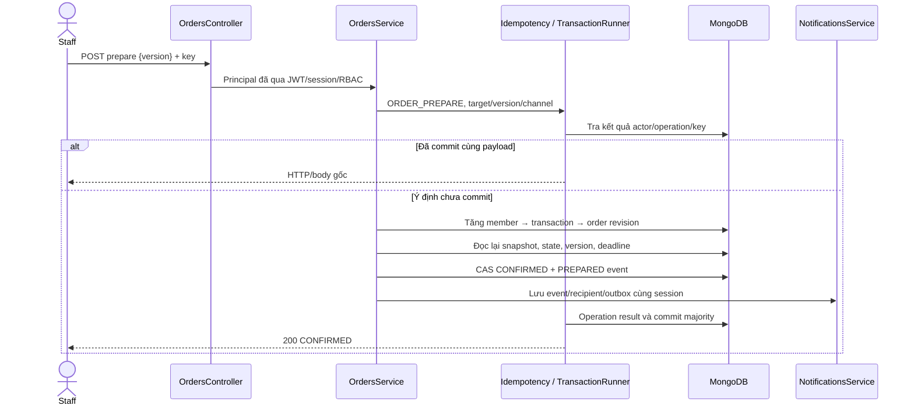

# US-43 — Xác nhận chuẩn bị đơn website

Nguồn: `PM/SPRINT6/[GM]Requirement_US-43.docx` v1.0, hợp đồng schema/H01/O01
trong US-41 và EN-06. Đã đọc toàn bộ văn bản và bảng của ba DOCX; không có ảnh
nhúng. Tham chiếu schema refund của US-45 để chỉ trả summary an toàn.

## API và quyền

| Endpoint | Quyền cố định | Hợp đồng |
| --- | --- | --- |
| `GET /api/orders` | `orders.read`, STAFF/ADMIN | channel, status, transactionStatus, q, memberId, fromDate, toDate, page, limit |
| `GET /api/orders/:id` | `orders.read`, STAFF/ADMIN | snapshot items/recipient/quầy, states/version/deadline, invoice/refunds summary, permittedActions |
| `POST /api/orders/:id/prepare` | `orders.prepare`, STAFF/ADMIN | `{version}`, UUID v4 Idempotency-Key, operation `ORDER_PREPARE`, HTTP 200 |
| `GET /api/operations/ORDER_PREPARE/:key` | STAFF/ADMIN, chính actor | Kết quả commit gốc; không tìm thấy không chứng minh thất bại |

Guard hiện có kiểm JWT, account/session/auth_version và vai trò mỗi request,
kể cả replay/lookup. Quyền read và prepare có metadata riêng; repo đang áp
dụng mapping vai trò cố định, không có override quyền từng tài khoản.
Không thêm quyền hoặc hành động thu tiền/bàn giao khi writer tương ứng chưa có.

List mặc định page1/limit20, tối đa100; sắp created_at DESC/_id DESC,
q tìm literal code đã trim≤120. Ngày Việt Nam bao gồm hai đầu, mặc định30 ngày
gần nhất, tối đa366 ngày. Query ngoài allowlist bị400. Count, transaction join
và dữ liệu một response đọc cùng snapshot. Empty có totalPages0.
API không trả evidence, reference ngân hàng, payout/credential, request key
hoặc guard_revision. Tiền là chuỗi nguyên VND; timestamp ISO UTC.

## UC-24: nhánh chuẩn bị

1. Staff/Admin mở `/staff/orders` hoặc `/admin/orders`, mặc định WEBSITE/PENDING.
2. Mở detail, xem snapshot và hạn giữ; kiểm hàng thực tế và đánh dấu xác nhận.
3. Gửi command với version hiện tại và một key. Giữ key/version khi mất phản hồi;
   tra operation hoặc gửi lại đúng yêu cầu. Không sinh key mới để sửa kết quả.
4. Server thực hiện một UnitOfWork: kiểm replay trước version; đọc ID bất biến,
   ghi tăng member.service_revision → transaction.guard_revision → order.guard_revision.
   Đọc lại order/transaction/items và lấy ServerClock sau khóa trên mỗi retry.
5. Chỉ WEBSITE/PENDING/HELD, chưa đến hạn, transaction RETAIL PENDING hoặc SETTLED
   hợp lệ. Kiểm owner liên kết, snapshot, tổng dòng/transaction, hạn created_at+24h.
   SETTLED cần invoice đúng tổng và payment SUCCEEDED đúng tổng; đơn0 có invoice0,
   không payment0. Không đọc giá/trạng thái catalog hiện tại.
6. CAS version: PENDING→CONFIRMED, confirmed_at/by và updated_at, version+1.
   Không đổi transaction business version/status, tồn/movement/payment/invoice/hạn.
7. Cùng session ghi order_events PREPARED, before/after status/version,
   event_key unique `ORDER_CONFIRMED:<id>`; notification/recipient/outbox EN-03
   và operation result. Recipient lấy dưới member gate tại commit. Không account
   vẫn lưu source event/notification, không tạo recipient giả. Socket do worker sau commit.
8. Cùng key/payload replay body200 gốc. Key khác trên CONFIRMED trả409
   ORDER_ALREADY_CONFIRMED với ID/version hiện tại, giữ nguyên confirmed timestamp/actor.
   Conflict khác tải lại detail/list và yêu cầu kiểm hàng lại.

GET hết hạn chỉ báo expired; không tự hủy/release. Đúng mốc bằng deadline đã
hết hạn. UI không gia hạn, không gọi chuẩn bị là đã thu hoặc đã bàn giao.
Thông báo dùng outbox/REST/dedupe EN-03 hiện có, không thêm socket riêng.

## Schema và vận hành

`orders`, `order_items`, `order_events` được khai báo theo US-41, không tạo
checkout/factory thay thế. Snapshot quầy hiện dùng chuỗi địa điểm
`pickup_location_snapshot`; writer US-41 cần dùng cùng biểu diễn khi được triển khai.
Order code/transaction unique, items(order,product) unique, event_key unique;
index member/channel/status/created/expiry phục vụ truy vấn. Không TTL.

Chạy `npm run ensure-indexes` và `npm run seed:access` ở backend trước khi dùng.
Preflight không sửa snapshot hoặc tiền/hạn; từ chối dữ liệu thiếu/sai revision,
orphan, sai tổng/state và reserved không khớp tổng HELD. Cần dừng writer khi chạy
preflight/đối chiếu; không tự reset reserved hoặc tạo lại dữ liệu lịch sử.
Prepare từ chối ghi nếu thiếu index bắt buộc. Không thêm env/dependency.

## Kiểm thử và giới hạn nghiệm thu

`npm run build` trước `npm run test:integration -- --runTestsByPath test/order-prepare.integration-spec.ts`.
Suite dùng MongoDB replica set8.0.17 thật, hai child Nest process/hai connection,
HTTP/JWT/session Guard thật, không mutex memory. Fixture order/item/reservation/
payment là dữ liệu test được ghi rõ trong test vì chưa có US-41 factory.
Các fixture này không chứng minh luồng tạo đơn hoặc thu RETAIL đã hoàn thành.

| Requirement | Bằng chứng tự động được triển khai | Giới hạn |
| --- | --- | --- |
| TC01–05, TC08 | Quyền/kênh/DTO, pending/settled/free, snapshot/tổng/hạn, so DB trước–sau | Checkout/retail payment writer chưa có |
| TC06 | Fault event/recipient/outbox/key, rollback cả status/guards và dữ liệu liên quan | Không giả rollback khoản thu thực ngoài hệ thống |
| TC07 | Không account/offline vẫn source event; member REST sync đúng recipient | Dedupe socket dùng EN-03 hiện có |
| TC09 | Pause trước khóa, fixture đổi version/cancelled hoặc clock rồi resume | Chưa phải race với command cancel/expiry/payment thật |
| TC10 | 10 vòng ×20 cùng key, 10 vòng hai key, hai process; một event/key/transition | Không thay toàn bộ EN-06 |
| TC11 | Mất response sau commit, lookup/replay, payload/target khác409, revoked401 | Không coi lookup404 là thất bại đã biết |
| TC12 | API ngày VN/phân trang; frontend loading/empty/error/pending/permission/recovery | Chưa duyệt UI thủ công trên trình duyệt |

Frontend: `npm test -- src/features/orders/orders.test.tsx`.
US-43-AC01/02 có kiểm thử phạm vi chuẩn bị; **AC03 và Done vẫn chưa đủ bằng chứng**
cho cạnh tranh liên story. US-41 (create/normal RETAIL settlement), US-44
(handover) và US-45 (cancel/expiry) chưa có writer. Chạy EN-04 và toàn EN-06 sau
khi tích hợp các dependency; không đánh dấu Done từ kết quả build hoặc fixture.
