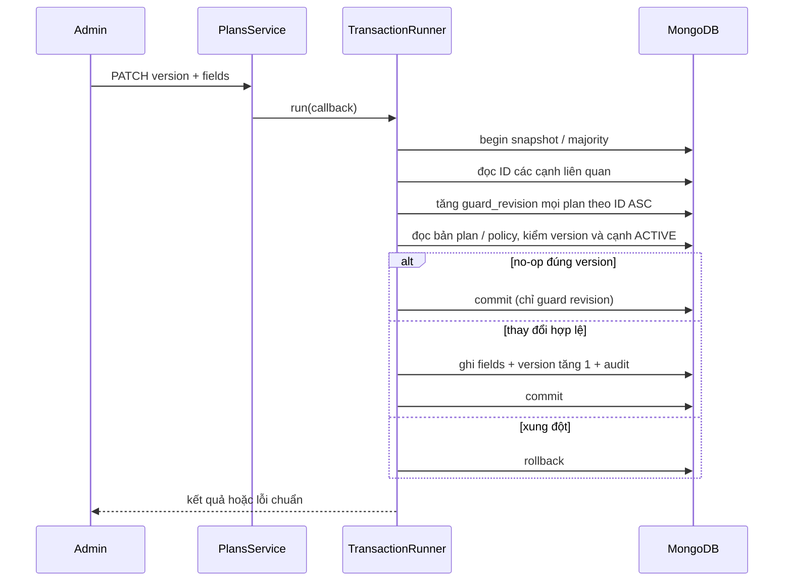

# US-12 / UC-30 — Danh mục gói tập và chính sách chuyển đổi

Nguồn: `Requirement_US-12.docx`, phiên bản 1.0, 27/10/2026, được cung cấp trong phiên triển khai. Hợp đồng này bổ sung UC-30 và mô hình dữ liệu mục 4.2; không thay đổi mã US-12-F01–F05, AC01–AC04 hoặc TC01–TC15. Không triển khai nghiệp vụ nâng cấp US-16.

## UC-30: tác nhân và luồng quản trị

- ADMIN quản trị tại `/admin/plans`: xem/lọc/phân trang, tạo, sửa, ngừng/bán lại gói; tab Chuyển đổi quản trị policy. Hai quyền `plans.manage` và `planPolicies.manage` đã có trong catalog cố định US-08, tái sử dụng qua `FixedPermission`.
- STAFF không được gọi API quản trị. Danh mục đọc phục vụ bán hàng thuộc endpoint của US-14; Member/Guest đọc public qua US-13. Story này xuất reader nội bộ, chưa thêm API thuộc hai story đó.
- Gói tạo ACTIVE, version 0. Code trim/uppercase, 3–30 ký tự `[A-Z0-9_-]`, unique và bất biến; kind bất biến. Name trim 2–120, benefits trim 1–1000, durationDays nguyên 1–3650. GYM quota 0, PT quota nguyên 1–10000.
- Price là chuỗi VND nguyên 0–999999999999 theo EN-02, lưu Decimal128; không dùng float. No-op đúng version giữ version/timestamps; stale version luôn 409, kể cả no-op.
- Policy có hướng, from/to khác nhau và bất biến; unique theo cặp. Rule cố định `PRORATED_REMAINING_DAYS_V1`, note trim tối đa 500. INACTIVE cho phép lưu nháp chưa đạt điều kiện giá/loại/quota. ACTIVE yêu cầu hai gói ACTIVE, cùng kind, giá đích lớn hơn, quota PT đích không thấp hơn nguồn.
- Theo F05, sửa giá/quota kiểm lại điều kiện loại/giá/quota của các policy ACTIVE; nếu vi phạm, trả POLICY_CONFLICT và yêu cầu ngừng policy trước. Ngừng/bán lại gói không tự đổi trạng thái policy; mỗi lần bật policy vẫn phải kiểm hai gói ACTIVE. Không xóa/sửa giao dịch, snapshot, membership, invoice hoặc quota đã bán.

## API

| Endpoint | Input / output |
| --- | --- |
| `GET /api/admin/plans` | page=1, limit=20 (tối đa 100), q?, kind?, status? → page PlanDto, gồm INACTIVE nếu không lọc |
| `GET /api/admin/plans/:id` | PlanDto |
| `POST /api/admin/plans` | code,name,kind,durationDays,sessionsQuota,price,benefits → 201 PlanDto |
| `PATCH /api/admin/plans/:id` | version bắt buộc; name?,durationDays?,sessionsQuota?,price?,benefits?,status? → `{plan,changed}` |
| `GET /api/admin/plan-policies` | page,limit,fromPlanId? → page PolicyDto |
| `POST /api/admin/plan-policies` | fromPlanId,toPlanId,status,note? → 201 PolicyDto |
| `PATCH /api/admin/plan-policies/:id` | version,status,note? → `{policy,changed}` |

Page là `{items,page,limit,total,totalPages}`, rỗng totalPages=0; sort created_at DESC, _id DESC. q tìm literal trên code/name (escape regex); query ngoài allowlist hoặc sai kiểu trả 400, kể cả query ở endpoint chi tiết/ghi. Không có DELETE. ID là ObjectId 24 hex; API camelCase, DB snake_case.

PlanDto: id,code,name,kind,durationDays,sessionsQuota,price,benefits,status,version,createdAt,updatedAt. PolicyDto: id,fromPlanId,toPlanId,status,note,ruleCode,version,createdAt,updatedAt. Guard revision và account audit không xuất API. Swagger `/api/docs` có DTO giới hạn input/output.

Lỗi chuẩn EN01-D03 `{error:{code,message,details?},requestId}`: 400 validation/ID, 401/403 auth/role, 404 không có dữ liệu; 409 PLAN_CODE_EXISTS, VERSION_CONFLICT, POLICY_EXISTS, POLICY_CONFLICT; 503 DB/transaction không sẵn sàng. POLICY_CONFLICT có details field `policy`, ID cạnh và code nguồn → đích để Admin xử lý.

POST không bắt buộc Idempotency-Key. FE không tự replay ghi; sau response không xác định/5xx hoặc trùng business key, khóa submit và cho tra code chuẩn hóa/cặp policy qua GET trước khi thử lại. Kết quả tìm được hiện lại để đối chiếu, không ghi đè tự động. Với 409 version, giữ draft và chỉ bỏ bản nhập khi người dùng chọn nút tải lại có cảnh báo.

## Mục 4.2: MongoDB

| Collection | Trường / index |
| --- | --- |
| `plans` | `_id=id` ObjectId; code unique; name,kind,duration_days Int32,session_quota Int32,price Decimal128,benefits,status; version Int32=0; guard_revision Int64=0; created_at,updated_at Date; created_by,updated_by ObjectId |
| `plan_conversion_policies` | `_id=id`; from_plan_id,to_plan_id ObjectId; status,rule_code,note; version Int32=0; created_at,updated_at Date; created_by,updated_by ObjectId |
| `plans` indexes | unique id; unique code (simple collation); created_at DESC + _id DESC |
| Policy indexes | unique id; unique (from_plan_id,to_plan_id); (to_plan_id,status); created_at DESC + _id DESC |

`PlansModule` sở hữu duy nhất hai schema. Khởi tạo dev/test tạo và kiểm index; production chỉ kiểm, thiếu thì dừng. `npm run ensure-indexes` tạo thêm index, không drop/sync/xóa dữ liệu. Không thêm env/dependency. MongoDB replica set bắt buộc cho sửa gói và mutation policy; standalone trả 503, không ghi rời. Nếu đã có dữ liệu plans ngoài schema đầy đủ, cần rà/chuẩn hóa thủ công trước khi tạo unique index; không tự suy ra code, kind, giá hoặc audit cho dữ liệu cũ.

## Transaction và reader US-13 / US-14



Khám phá cạnh và tập ID diễn ra bên trong mỗi callback retry. Sửa plan khóa plan đó và hai đầu các cạnh ACTIVE liên quan; policy mutation khóa cả hai đầu cùng các plan của cạnh ACTIVE kề hai đầu. `DataGuardsService.acquire` deduplicate/sort IDs theo EN-02. Một policy mới/bật đồng thời cũng ghi guard hai đầu, nên xung đột ghi buộc driver retry cả bước khám phá; không có khóa in-memory và không Promise.all trong một session.

`PlansModule` export `PlanReaderService`:

- `publicCatalog(query)` chỉ ACTIVE và projection id,code,name,kind,durationDays,sessionsQuota,price,benefits,version; US-13 sở hữu controller/quyền public.
- `readForSale(session, id, expectedVersion, targets?)` gọi **một lần** ở đầu callback transaction US-14; truyền tất cả `DataGuardTargets` khác (plans, members, transactions, accountAdministration nếu có). Reader lấy toàn bộ khóa đúng thứ tự trước đọc điều khoản, so version/status rồi trả snapshot dạng giá string. Không lấy khóa member/transaction trước rồi gọi reader; không lồng transaction.
- US-14 phải ghi snapshot trả về và amountDue trong **cùng session**, không đọc lại giá live khi thu sale PENDING. Nếu sửa/ngừng commit trước, reader trả PLAN_CHANGED; nếu sale commit trước, snapshot cũ tiếp tục dùng.

Hiện source chưa có nghiệp vụ/API bán gói US-14. Test dùng contract probe ghi service_sales/transactions trong transaction thật qua reader, xác minh race và snapshot cũ không đổi; đây chưa phải nghiệm thu luồng bán/thu tiền end-to-end của US-14.

## Kiểm chứng và truy vết

| Requirement / AC / TC | Bằng chứng tự động |
| --- | --- |
| F01–F02 / AC01 / TC01–04 | plans.integration: login thật, toàn bộ 7 endpoint × Guest/STAFF/TRAINER/MEMBER, DTO, mã unique chuẩn hóa, field bất biến, BSON types |
| F03–F04 / AC02 / TC05–08 | hai Nest app/kết nối cùng replica set, CAS, stale/no-op, sale-reader vs ngừng/giá, lịch sử snapshot/amountDue |
| F05 / AC03 / TC09–12 | nháp/bật policy, self/cross-kind/giá/quota, unique race, policy vs giá, ngừng policy trước sửa gói |
| AC04 / TC13–15 | lịch sử không đổi, GET khôi phục response mất, validation/query/projection/OpenAPI; plans.test.tsx: filter, quota theo kind, pending, field/version/conflict, tra cứu sau lỗi |

Lệnh sau khi cài dependencies hiện có:

```sh
# backend
npm run typecheck
npm run typecheck:test
npm run build
npm run test:integration -- --runTestsByPath test/plans.integration-spec.ts
# frontend
npm run typecheck
npm run build
npm test -- --pool=threads --maxWorkers=1 src/features/plans/plans.test.tsx
```

Integration tự khởi động mongod thật 8.0.17 replica set tạm, không dùng DB dev. Kiểm UI browser thực tế vẫn cần trước nghiệm thu: Admin tạo GYM/PT, ngừng/bán lại, policy hợp lệ/không hợp lệ, hai tab cùng sửa để kiểm 409, STAFF vào trang/API bị từ chối. Không đánh dấu Done toàn AC chỉ từ build hoặc test contract probe.
